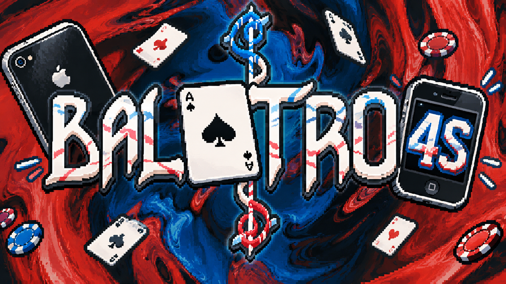
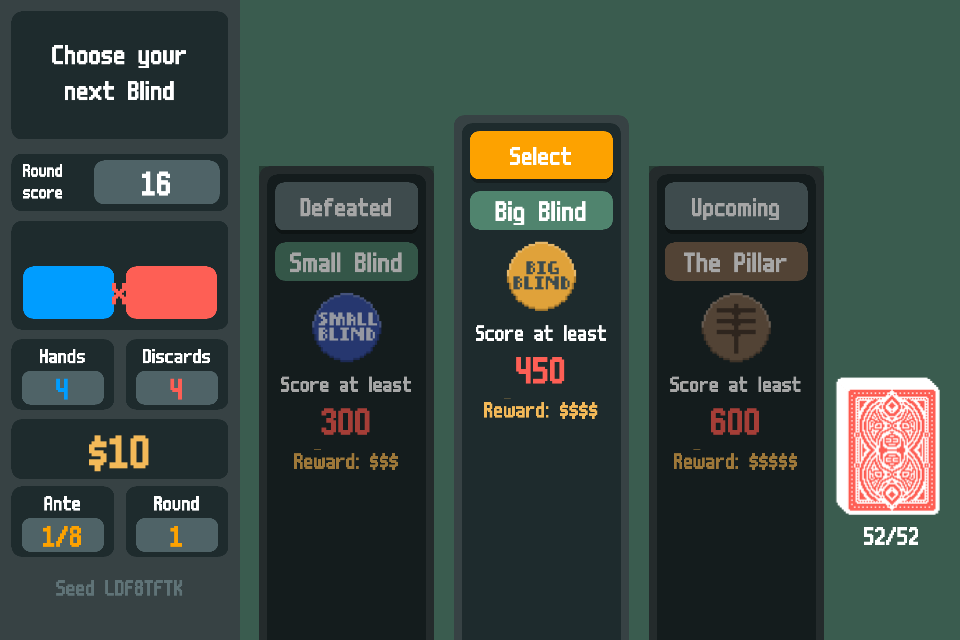
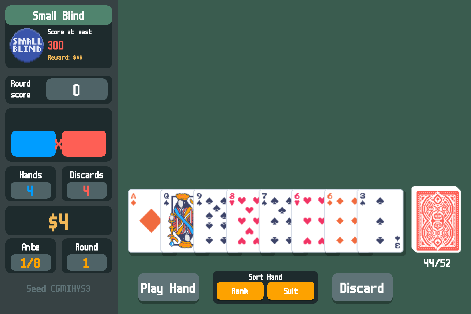

# Balatro4S

Balatro4S is a demake of [Balatro](https://www.playbalatro.com/) for the
iPhone 4S on iOS 6.1.3 (jailbroken). It is a native rewrite in C and
Objective-C, with OpenGL ES 2.0. You install it as a .deb package.

This is a fan project. It is not from LocalThunk or Playstack.

**The status:** early work. Version 0.2.0 plays a full run of 8 antes with
the standard deck, with the seeds of Balatro. The shop, the jokers, and the
other cards come in the next versions. The plan is in
[TODO.md](TODO.md), and the decisions and their reasons are in
[docs/decisions.md](docs/decisions.md).

 

## You need a copy of Balatro

This repository and the .deb hold no file of Balatro. The art, the sounds,
the font, and the text belong to their owners. Balatro4S reads them from
the `Balatro.love` file of your own copy.

1. Buy Balatro, for example on Steam.
2. Find `Balatro.love`. On a Mac, it is in
   `Balatro.app/Contents/Game/Balatro.app/Contents/Resources/`. On
   Windows, `Balatro.exe` is a zip archive that holds the same files.
3. Copy it to `/var/mobile/Media/Balatro4S/Balatro.love` on the phone,
   with an AFC tool or with `scp`.

Balatro4S follows Balatro 1.0.1o.

## Install

1. Download the .deb from the latest
   [release](https://github.com/Stiven-Gjekaj/Balatro4S/releases).
2. Copy it to the phone, for example with `scp`.
3. Install it as root: `dpkg -i io.github.stivengjekaj.balatro4s_0.2.0_iphoneos-arm.deb`.

The APT of Cydia on iOS 6 speaks only TLS 1.0, and GitHub accepts only TLS
1.2, so `dpkg -i` is the way on iOS 6.

## Build

You need a Mac with Xcode, the iPhoneOS 9.3 SDK in `sdks/`, and a
jailbroken iPhone at `ssh iphone4s`.

    ./fix-sdk.sh           # one time, after you unpack the SDK
    scripts/test.sh        # the tests on the Mac
    scripts/test.sh --phone
    scripts/install.sh     # build, install, and open the app on the phone
    scripts/deb.sh         # build the .deb

## Licence

The code is under the MIT licence. See [LICENSE](LICENSE).
